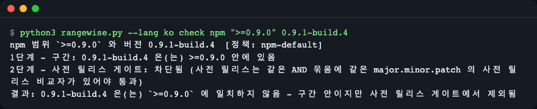
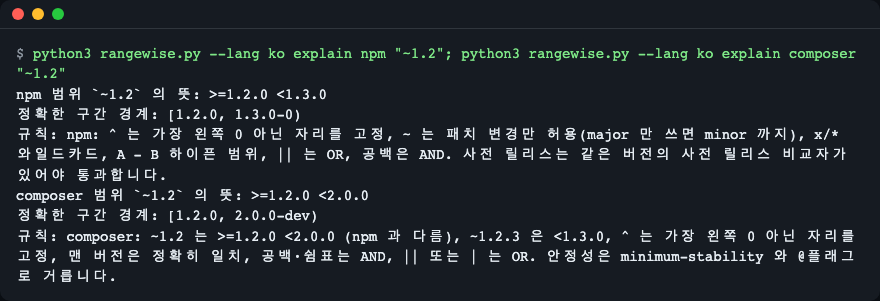
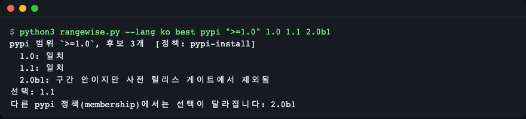
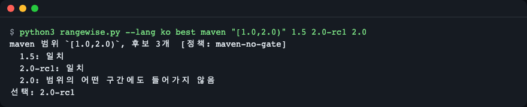
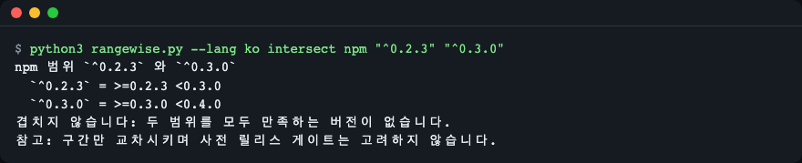
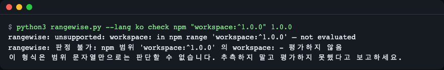
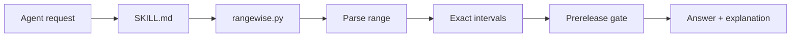

# rangewise

[English](README.md) | **한국어**

패키지 생태계(npm, Cargo, PyPI, Composer, Maven)마다 다른 버전 범위 규칙대로 의존성 범위를 판정하는 에이전트 스킬입니다. 에이전트가 "이 버전이 이 범위에 들어가나?", "어떤 버전이 골라지나?", "두 요구가 충돌하나?"라는 질문을 받으면, 기억으로 답하지 않고 오프라인 스크립트 하나를 실행해 계산된 구간을 보고합니다.


*`check npm ">=0.9.0" 0.9.1-build.4`: 1단계는 구간 안이라고 하고, 2단계는 사전 릴리스 게이트가 막는다고 합니다.*

## 무엇을 하나
- **생태계마다 자기 문법으로 읽습니다.** `^`, `~`, 맨 버전, 와일드카드, 하이픈 범위, `||`, PEP 440 지정자(`~=`, `==1.*`, `===`), Maven 구간(`[1.0,2.0)`)을 모두 정확한 구간 목록으로 바꿉니다.
- **두 단계로 판정하고 둘 다 보여 줍니다.** 1단계: 버전이 구간 안인가. 2단계: 그 생태계의 사전 릴리스 규칙이 통과시키는가. "범위 안에 있다"와 "설치된다"는 같은 말이 아닙니다.
- **명령 네 개.** `check`(버전 하나), `best`(후보 중 선택), `intersect`(두 범위가 겹치는가), `explain`(범위가 실제로 허용하는 것).
- **추측하지 않고 "판정하지 않음"이라고 말합니다.** 범위 문자열 밖의 정보가 필요한 형식(`workspace:^1.0.0`, Maven `${project.version}`, PEP 508 마커)은 종료 코드 3으로 끝납니다.
- **영어·한국어 설명**, 키가 영어로 고정된 JSON 출력, 네트워크 없음, Python 표준 라이브러리만 사용.

같은 기호도 생태계마다 뜻이 다릅니다. 아래 경계는 스크립트가 그대로 출력하는 값입니다.

| 범위 | npm | Cargo | Composer |
|---|---|---|---|
| `~1.2` | `>=1.2.0 <1.3.0` | `>=1.2.0 <1.3.0` | `>=1.2.0 <2.0.0` |
| `^0.2.3` | `>=0.2.3 <0.3.0` | `>=0.2.3 <0.3.0` | `>=0.2.3 <0.3.0` |
| `0.2.3` | 정확히 0.2.3 | 캐럿, `>=0.2.3 <0.3.0` | 정확히 0.2.3 |

전체 표는 [`skills/rangewise/references/ecosystems.md`](skills/rangewise/references/ecosystems.md)(영어)에 있습니다.

## 설치
**Claude Code**
```
/plugin marketplace add LeeGyeongPil/rangewise
/plugin install rangewise@rangewise-skill
```
**Codex 등 다른 에이전트(Agent Skills 표준)** — `skills/rangewise` 폴더를 에이전트의 스킬 폴더(예: 프로젝트의 `.agents/skills/`)로 복사합니다.

**설치 없이 직접 실행**(Python 3.10 이상):
```
python3 skills/rangewise/scripts/rangewise.py check npm "^0.2.3" 0.3.0
```

## 사용법
에이전트에게 평소 말투로 물으면 됩니다. 스킬이 잡아내도록 쓰인 요청의 예입니다.

- "package.json 의 `^0.2.3` 이 0.3.0 을 허용해?"
- "레지스트리에 0.9.0 과 0.9.1-build.4 가 있는데, `>=0.9.0` 이면 npm 은 어느 쪽을 골라?"
- "Maven 은 `[1.0,2.0)` 범위에서 2.0-rc1 을 고를까?"

명령을 직접 실행할 수도 있습니다. 아래 예시는 `--lang ko` 로 실행한 출력입니다(명령·JSON 키·오류 접두어는 영어 그대로).

**사전 릴리스 게이트**(`check`, 답이 "아니오"여도 종료 코드는 0):
```
$ python3 skills/rangewise/scripts/rangewise.py check npm ">=0.9.0" 0.9.1-build.4 --lang ko
npm 범위 `>=0.9.0` 와 버전 0.9.1-build.4  [정책: npm-default]
1단계 - 구간: 0.9.1-build.4 은(는) >=0.9.0 안에 있음
2단계 - 사전 릴리스 게이트: 차단됨 (사전 릴리스는 같은 AND 묶음에 같은 major.minor.patch 의 사전 릴리스 비교자가 있어야 통과)
결과: 0.9.1-build.4 은(는) `>=0.9.0` 에 일치하지 않음 - 구간 안이지만 사전 릴리스 게이트에서 제외됨
```

**같은 기호, 다른 뜻**(`explain`):
```
$ python3 skills/rangewise/scripts/rangewise.py explain npm "~1.2" --lang ko
npm 범위 `~1.2` 의 뜻: >=1.2.0 <1.3.0
정확한 구간 경계: [1.2.0, 1.3.0-0)
$ python3 skills/rangewise/scripts/rangewise.py explain composer "~1.2" --lang ko
composer 범위 `~1.2` 의 뜻: >=1.2.0 <2.0.0
정확한 구간 경계: [1.2.0, 2.0.0-dev)
```
(각 명령은 `규칙:` 한 줄도 더 출력하며 여기서는 생략했습니다.)


*같은 `~1.2` 인데 npm 은 1.3.0 미만, Composer 는 2.0.0 미만까지 허용합니다.*

**PyPI 후보 선택**(`best`): pip 은 `1.1` 을 설치하지만 packaging 26 의 `contains()` 는 `2.0b1` 도 받아들이므로 두 결과를 함께 보여 줍니다.
```
$ python3 skills/rangewise/scripts/rangewise.py best pypi ">=1.0" 1.0 1.1 2.0b1 --lang ko
pypi 범위 `>=1.0`, 후보 3개  [정책: pypi-install]
  1.0: 일치
  1.1: 일치
  2.0b1: 구간 안이지만 사전 릴리스 게이트에서 제외됨
선택: 1.1
다른 pypi 정책(membership)에서는 선택이 달라집니다: 2.0b1
```

*`--pre-policy install`(기본)은 pip 을, `membership` 은 packaging 26 의 `contains()` 를 따릅니다.*

**Maven 에는 사전 릴리스 게이트가 없습니다** — `2.0-rc1` 은 `2.0` 보다 앞에 정렬되므로 `[1.0,2.0)` 안에 들어가고 선택됩니다.
```
$ python3 skills/rangewise/scripts/rangewise.py best maven "[1.0,2.0)" 1.5 2.0-rc1 2.0 --lang ko
maven 범위 `[1.0,2.0)`, 후보 3개  [정책: maven-no-gate]
  1.5: 일치
  2.0-rc1: 일치
  2.0: 범위의 어떤 구간에도 들어가지 않음
선택: 2.0-rc1
```

*Maven 은 `[1.0,2.0)` 에서 `2.0-rc1` 을 고릅니다.*

**두 요구를 한 버전이 만족할 수 있나?**(`intersect`):
```
$ python3 skills/rangewise/scripts/rangewise.py intersect npm "^0.2.3" "^0.3.0" --lang ko
npm 범위 `^0.2.3` 와 `^0.3.0`
  `^0.2.3` = >=0.2.3 <0.3.0
  `^0.3.0` = >=0.3.0 <0.4.0
겹치지 않습니다: 두 범위를 모두 만족하는 버전이 없습니다.
참고: 구간만 교차시키며 사전 릴리스 게이트는 고려하지 않습니다.
```

*`^0.2.3` 을 요구하는 패키지와 `^0.3.0` 을 요구하는 패키지는 한 버전을 함께 쓸 수 없습니다.*

**판정하지 않음**(종료 코드 3, 추측하지 않음):
```
$ python3 skills/rangewise/scripts/rangewise.py check npm "workspace:^1.0.0" 1.0.0 --lang ko
rangewise: unsupported: workspace: in npm range 'workspace:^1.0.0' — not evaluated
rangewise: 판정 불가: npm 범위 'workspace:^1.0.0' 의 workspace: - 평가하지 않음
이 형식은 범위 문자열만으로는 판단할 수 없습니다. 추측하지 말고 평가하지 못했다고 보고하세요.
```

*밖의 정보가 필요한 형식은 추측하지 않고 알려 줍니다.*

**옵션**
- `--json` 은 JSON 객체 하나를 출력합니다. 명령별 키: `check` 는 `ecosystem`, `range`, `policy`, `normalized`, `matches`, `reason`, `in_interval`, `prerelease_gate`, `best` 는 `selected`, `matching`, `skipped`(PyPI 만 `by_policy` 추가), `intersect` 는 `overlaps`, `intersection`, `explain` 은 `rule_summary`. 키는 언어와 상관없이 영어입니다.
- `--exit-status` 를 주면 "아니오" 답이 종료 코드 1이 됩니다(`check` 불일치, `best` 선택 없음, `intersect` 겹침 없음). 없으면 계산이 끝난 답은 모두 0입니다.
- `--pre-policy install|membership`(PyPI), `--include-prerelease`(npm, Cargo), `--minimum-stability stable|RC|beta|alpha|dev`(Composer).
- `best --from FILE` 은 한 줄에 버전 하나를 읽습니다(빈 줄·`#` 주석 무시). `-` 는 표준 입력입니다.
- 종료 코드: 0 계산 완료, 1 `--exit-status` 일 때만, 2 잘못된 입력(UTF-8 이 아닌 후보 파일, 4300자리를 넘는 숫자 포함), 3 판정하지 않는 형식.

**언어.** `--lang en|ko` 를 주거나 `RANGEWISE_LANG` 을 설정합니다. 없으면 `LC_ALL`, `LC_MESSAGES`, `LANG` 순으로 읽고, 한국어가 아니면 영어로 나옵니다.
```
$ python3 skills/rangewise/scripts/rangewise.py explain npm "^0.2.3" --lang ko
npm 범위 `^0.2.3` 의 뜻: >=0.2.3 <0.3.0
정확한 구간 경계: [0.2.3, 0.3.0-0)
```
(한국어 출력에는 `규칙:` 줄도 함께 나옵니다.)

## 검증 결과
<!-- skill-eval:start -->
| 확인 | 결과 |
|---|---|
| 필요할 때 불림 | 14/14 |
| 필요 없을 때 안 불림 | 11/11 |
| 스킬로 푼 작업 | 7/7 |
| 스킬 없이 푼 작업(기준선) | 0/7 |
| 평균 점수 차이(Δ) | +0.58 |
| 가짜 스크립트를 잡아낸 비율 | 7/7 |
| Codex CLI | 작업 7/7 통과 · 확인됨 |

Claude Code 2.1.322 · sonnet · 케이스마다 3회 · 2026-11-17 측정 · codex-cli 0.154.0
<!-- skill-eval:end -->

테스트의 기대값(`tests/data/`)은 npm 은 node-semver 7.8.6, PyPI 는 packaging 26.3(membership)과 24.2(install)로 만들었습니다. Cargo·Composer·Maven 값은 공식 문서에서 가져왔고 사례마다 출처 URL이 있습니다. 판정 결과만 저장했고 참조 구현 코드는 옮기지 않았습니다. `tools/refgen/` 에 다시 만드는 방법이 있으며, 스킬 실행이나 테스트에는 그 패키지가 필요 없습니다.

## 동작 원리

`SKILL.md` 는 에이전트에게 언제 스크립트를 부르고 무엇을 보고할지(생태계, 정책, 두 단계)를 알려 줍니다. 스크립트는 범위 문자열을 그 생태계의 문법으로 파싱해 구간들의 합집합으로 바꾸고, 사전 릴리스·안정성 규칙을 적용합니다. 읽는 것은 명령줄 인자(와 `--from` 으로 준 파일)뿐이고, 쓰는 곳은 표준 출력·표준 오류뿐입니다. 네트워크 접근, 레지스트리 조회, lockfile 해석은 하지 않습니다.

## 언제 쓰나
- 잘 맞는 상황: 에이전트가 버전 제약을 설명하거나 고치려는 순간에, 구간과 사전 릴리스 답을 기억이 아니라 계산으로 받고 싶을 때.
- 맞지 않는 상황: 최신 릴리스 조회, 전체 의존성 그래프 해석, 취약점 점검, lockfile 편집. 레지스트리를 보는 실제 해석은 패키지 관리자(`npm`, `cargo`, `pip`, `composer`, `mvn`)를 쓰세요.
- [node-semver](https://github.com/npm/node-semver)와 [packaging](https://github.com/pypa/packaging) 같은 참조 구현은 각각 한 생태계의 기준입니다. 이 스킬은 다섯 생태계를 한 스크립트로 다루며, 지원하지 않는다고 밝힌 형식에서는 그 구현과 다를 수 있습니다.

## 개발
```
uv sync && uv run pytest -q
```
마지막 실행: 153개 통과. `evals/` 에 평가 세트(발동 요청 14개, 가까운·먼 미발동 요청 11개, 픽스처가 있는 작업 케이스 7개)가 있으며 `claude plugin eval` 로 돌립니다.

## 라이선스
MIT
