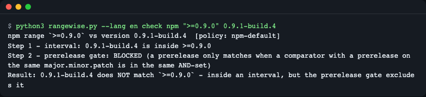
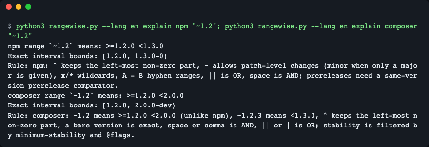
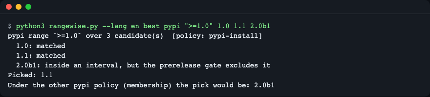
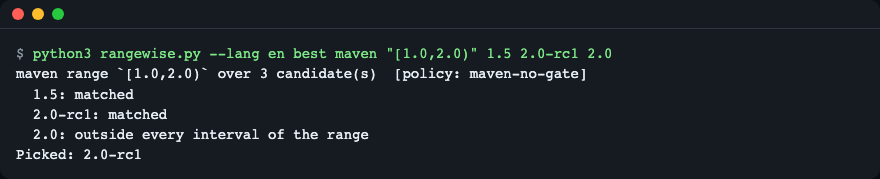
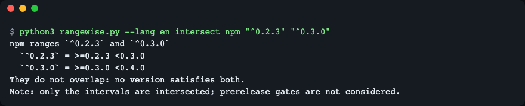
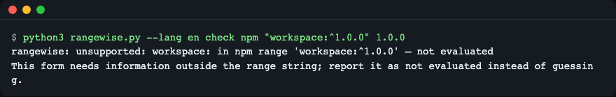
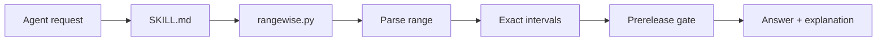

# rangewise

**English** | [한국어](README.ko.md)

An agent skill that decides dependency version ranges the way each package ecosystem does (npm, Cargo, PyPI, Composer, Maven). When an agent is asked "does this version satisfy this range?", "which one gets picked?" or "do these two requirements conflict?", it runs one offline script and reports computed intervals instead of answering from memory.


*`check npm ">=0.9.0" 0.9.1-build.4`: step 1 says the version is inside the interval, step 2 says the prerelease gate blocks it.*

## What it does
- **Reads each ecosystem's own syntax.** `^`, `~`, bare versions, wildcards, hyphen ranges, `||`, PEP 440 specifiers (`~=`, `==1.*`, `===`) and Maven intervals (`[1.0,2.0)`) are all turned into a list of exact intervals.
- **Decides in two steps and shows both.** Step 1: is the version inside an interval. Step 2: does the ecosystem's prerelease rule let it through. "Inside the range" and "gets installed" are not the same thing.
- **Four commands.** `check` (one version), `best` (pick from candidates), `intersect` (do two ranges overlap), `explain` (what a range really allows).
- **Says "not evaluated" instead of guessing.** Forms that need information outside the range string (`workspace:^1.0.0`, Maven `${project.version}`, PEP 508 markers) exit with code 3.
- **English and Korean explanations**, JSON output with fixed English keys, no network, Python standard library only.

The same symbol means different things per ecosystem. Bounds below are the exact ones the script prints:

| Range | npm | Cargo | Composer |
|---|---|---|---|
| `~1.2` | `>=1.2.0 <1.3.0` | `>=1.2.0 <1.3.0` | `>=1.2.0 <2.0.0` |
| `^0.2.3` | `>=0.2.3 <0.3.0` | `>=0.2.3 <0.3.0` | `>=0.2.3 <0.3.0` |
| `0.2.3` | exactly 0.2.3 | caret, `>=0.2.3 <0.3.0` | exactly 0.2.3 |

The full table is in [`skills/rangewise/references/ecosystems.md`](skills/rangewise/references/ecosystems.md).

## Install
**Claude Code**
```
/plugin marketplace add LeeGyeongPil/rangewise
/plugin install rangewise@rangewise-skill
```
**Codex and other agents (Agent Skills standard)** — copy `skills/rangewise` into the agent's skills folder (for example `.agents/skills/` in a project).

**By hand, no install** (Python 3.10 or newer):
```
python3 skills/rangewise/scripts/rangewise.py check npm "^0.2.3" 0.3.0
```

## Use it
Ask your agent in plain words. These requests are what the skill is written to pick up:

- "Does `^0.2.3` in package.json allow 0.3.0?"
- "The registry has 0.9.0 and 0.9.1-build.4 — which one does npm pick for `>=0.9.0`?"
- "Would Maven pick 2.0-rc1 for the range `[1.0,2.0)`?"

You can also run the commands yourself. All examples below were run with `--lang en` or `RANGEWISE_LANG=en`.

**Prerelease gate** (`check`, exit code 0 even though the answer is "no"):
```
$ python3 skills/rangewise/scripts/rangewise.py check npm ">=0.9.0" 0.9.1-build.4
npm range `>=0.9.0` vs version 0.9.1-build.4  [policy: npm-default]
Step 1 - interval: 0.9.1-build.4 is inside >=0.9.0
Step 2 - prerelease gate: BLOCKED (a prerelease only matches when a comparator with a prerelease on the same major.minor.patch is in the same AND-set)
Result: 0.9.1-build.4 does NOT match `>=0.9.0` - inside an interval, but the prerelease gate excludes it
```

**Same symbol, different meaning** (`explain`):
```
$ python3 skills/rangewise/scripts/rangewise.py explain npm "~1.2"
npm range `~1.2` means: >=1.2.0 <1.3.0
Exact interval bounds: [1.2.0, 1.3.0-0)
$ python3 skills/rangewise/scripts/rangewise.py explain composer "~1.2"
composer range `~1.2` means: >=1.2.0 <2.0.0
Exact interval bounds: [1.2.0, 2.0.0-dev)
```
(Each command also prints a one-line `Rule:` sentence, left out here.)


*The same `~1.2`: npm stops below 1.3.0, Composer below 2.0.0.*

**Pick from candidates, PyPI** (`best`): pip would install `1.1`, while `contains()` in packaging 26 would accept `2.0b1`, so both are shown.
```
$ python3 skills/rangewise/scripts/rangewise.py best pypi ">=1.0" 1.0 1.1 2.0b1
pypi range `>=1.0` over 3 candidate(s)  [policy: pypi-install]
  1.0: matched
  1.1: matched
  2.0b1: inside an interval, but the prerelease gate excludes it
Picked: 1.1
Under the other pypi policy (membership) the pick would be: 2.0b1
```

*`--pre-policy install` (default) follows pip; `membership` follows `contains()` in packaging 26.*

**Maven has no prerelease gate** — `2.0-rc1` sorts below `2.0`, so it is inside `[1.0,2.0)` and is picked:
```
$ python3 skills/rangewise/scripts/rangewise.py best maven "[1.0,2.0)" 1.5 2.0-rc1 2.0
maven range `[1.0,2.0)` over 3 candidate(s)  [policy: maven-no-gate]
  1.5: matched
  2.0-rc1: matched
  2.0: outside every interval of the range
Picked: 2.0-rc1
```

*Maven picks `2.0-rc1` from `[1.0,2.0)`.*

**Two requirements, one version?** (`intersect`):
```
$ python3 skills/rangewise/scripts/rangewise.py intersect npm "^0.2.3" "^0.3.0"
npm ranges `^0.2.3` and `^0.3.0`
  `^0.2.3` = >=0.2.3 <0.3.0
  `^0.3.0` = >=0.3.0 <0.4.0
They do not overlap: no version satisfies both.
Note: only the intervals are intersected; prerelease gates are not considered.
```

*A `^0.2.3` package and a `^0.3.0` package cannot share one version.*

**Not evaluated** (exit code 3, nothing is guessed):
```
$ python3 skills/rangewise/scripts/rangewise.py check npm "workspace:^1.0.0" 1.0.0
rangewise: unsupported: workspace: in npm range 'workspace:^1.0.0' — not evaluated
This form needs information outside the range string; report it as not evaluated instead of guessing.
```

*Forms that need outside information are reported, not guessed.*

**Options**
- `--json` prints one JSON object. Keys per command: `check` gives `ecosystem`, `range`, `policy`, `normalized`, `matches`, `reason`, `in_interval`, `prerelease_gate`; `best` gives `selected`, `matching`, `skipped` (plus `by_policy` for PyPI only); `intersect` gives `overlaps`, `intersection`; `explain` gives `rule_summary`. Keys stay in English whatever the language.
- `--exit-status` makes a "no" answer exit with code 1 (`check` mismatch, `best` with no pick, `intersect` with no overlap). Without it, any computed answer exits 0.
- `--pre-policy install|membership` (PyPI), `--include-prerelease` (npm, Cargo), `--minimum-stability stable|RC|beta|alpha|dev` (Composer).
- `best --from FILE` reads one version per line (blank lines and `#` comments ignored); `-` reads stdin.
- Exit codes: 0 computed, 1 only with `--exit-status`, 2 malformed input (including a candidate file that is not UTF-8 and numbers longer than 4300 digits), 3 form not evaluated.

**Language.** Pass `--lang en|ko` or set `RANGEWISE_LANG`; otherwise `LC_ALL`, `LC_MESSAGES`, `LANG` are read, and anything that is not Korean falls back to English.
```
$ python3 skills/rangewise/scripts/rangewise.py explain npm "^0.2.3" --lang ko
npm 범위 `^0.2.3` 의 뜻: >=0.2.3 <0.3.0
정확한 구간 경계: [0.2.3, 0.3.0-0)
```
(The Korean output also prints a `규칙:` line.)

## Verified behavior
<!-- skill-eval:start -->
| Check | Result |
|---|---|
| Triggers when it should | 14/14 |
| Stays quiet when it should not | 11/11 |
| Tasks solved with the skill | 7/7 |
| Tasks solved without it (baseline) | 0/7 |
| Mean score gain (Δ) | +0.58 |
| Tasks that catch a broken script | 7/7 |
| Codex CLI | 7/7 tasks · verified |

Measured 2026-11-17 with Claude Code 2.1.322 · sonnet · 3 runs per case · codex-cli 0.154.0
<!-- skill-eval:end -->

The expected values behind the tests (`tests/data/`) were generated from node-semver 7.8.6 for npm and packaging 26.3 (membership) and 24.2 (install) for PyPI. Cargo, Composer and Maven values come from their official documentation, with a source URL per case. Only the verdicts are stored, no reference code is copied. `tools/refgen/` explains how to regenerate them; running the skill or the tests does not need those packages.

## How it works

`SKILL.md` tells the agent when to call the script and what to report (ecosystem, policy, both steps). The script parses the range string with the ecosystem's grammar, turns it into a union of intervals, then applies the prerelease or stability rule. It reads only its command-line arguments (and a file given to `--from`); it writes only to stdout and stderr. No network access, no registry lookup, no lockfile parsing.

## When to use it
- Good fit: an agent is about to explain or change a version constraint and you want the interval and prerelease answer computed, not recalled.
- Not for: looking up the latest release, resolving a whole dependency graph, vulnerability audits or lockfile edits. Use the package manager itself (`npm`, `cargo`, `pip`, `composer`, `mvn`) for real resolution against a registry.
- Reference implementations such as [node-semver](https://github.com/npm/node-semver) and [packaging](https://github.com/pypa/packaging) are the authority for one ecosystem each; this skill covers five in one script and can differ from them on forms it lists as unsupported.

## Development
```
uv sync && uv run pytest -q
```
Last run: 153 passed. The `evals/` folder holds the evaluation set (14 trigger prompts, 11 near and far non-trigger prompts, 7 task cases with fixtures); run it with `claude plugin eval`.

## License
MIT
